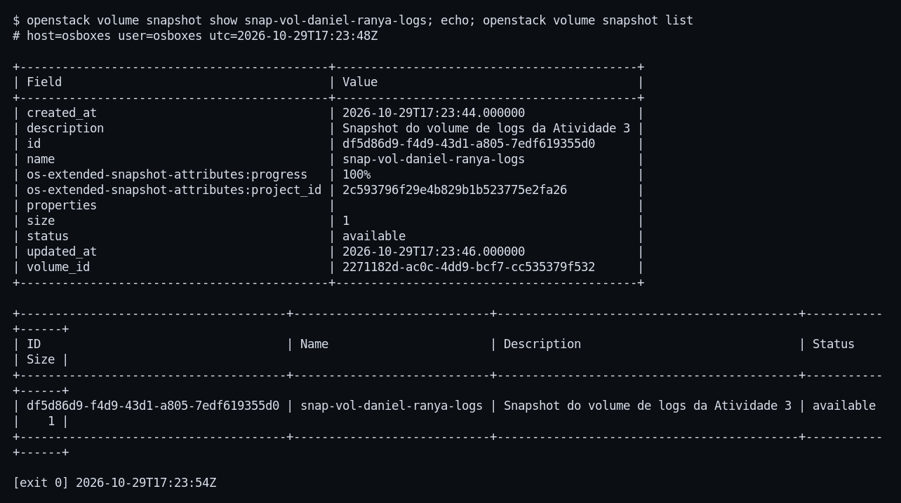
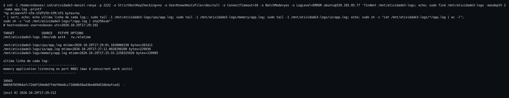
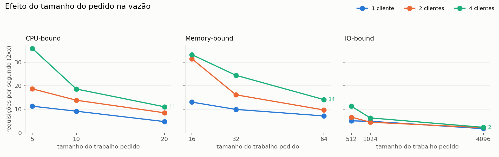
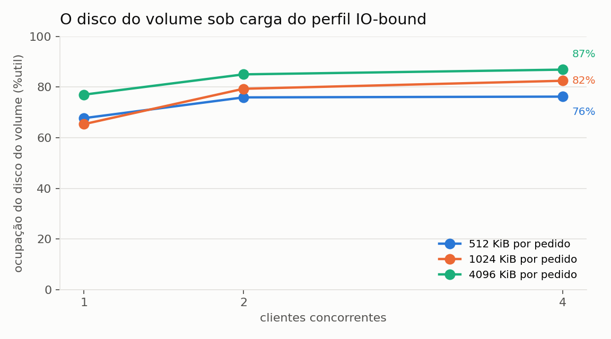
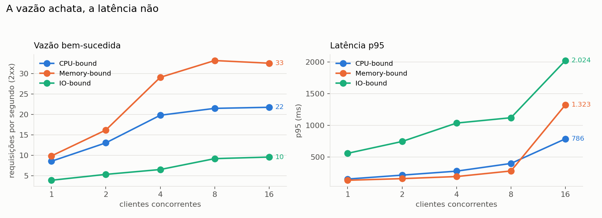
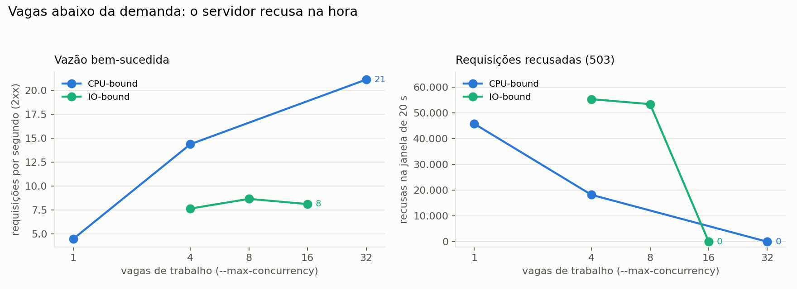
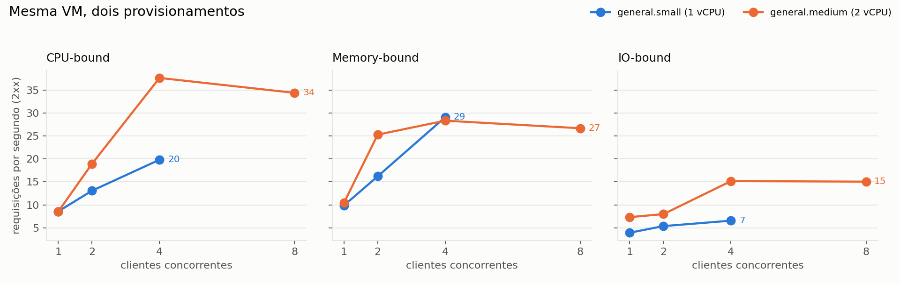
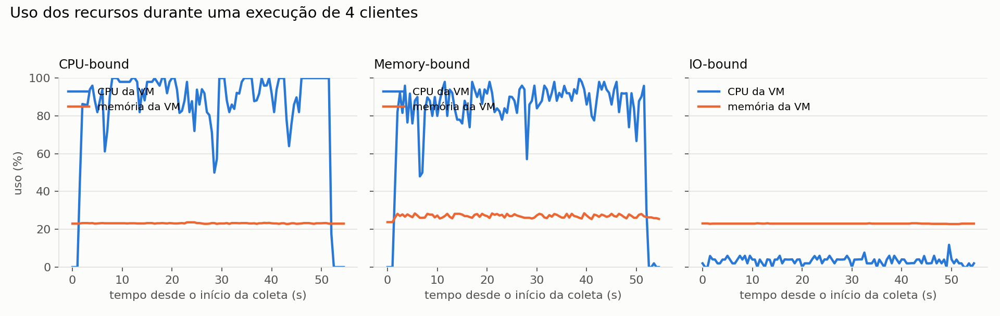

# Relatório — Atividade 3: Usando Nuvem IaaS

**Disciplina:** Provisionamento e Operação de Infraestrutura
**Grupo:** Daniel Anderson de Souza Silva · Ranya Duran Greco
**Ambiente:** Nuvem IaaS do LSD — projeto `Provisionamento` (OpenStack)
**Data da execução:** 29 de outubro de 2026

---

## 1. Resumo

Esta atividade levou as três aplicações da Atividade 2 (perfis CPU-bound,
Memory-bound e IO-bound) de uma máquina virtual local para a **Nuvem IaaS do
LSD**, operada por linha de comando OpenStack a partir da VDI de provisionamento
do professor.

O que foi construído: um par de chaves, uma VM `general.small` com a imagem
`ubuntu-24.04`, um grupo de segurança, um volume de 1 GB montado e usado para os
logs das aplicações, três listeners no balanceador compartilhado `poi-atividades`
e o snapshot da VM já configurada. O acesso SSH à VM também passa pelo
balanceador, como o enunciado pede.

Depois do deploy, medimos as três aplicações sob carga: os nove cenários base
repetidos três vezes — **15.237 requisições e nenhum erro** — mais as matrizes de
tamanho do trabalho, de saturação, de provisionamento, de mistura de tamanhos e
de número de vagas. São 107 execuções pela VIP e 24 dentro da VM. Os resultados mostram onde cada perfil satura os
recursos de 1 vCPU e 2 GB, e estão no capítulo 5 com tabela, gráficos e
discussão.

Todo o processo foi feito pela CLI do OpenStack. As fases automatizadas estão em
[`automation/`](automation/) e cada task tem um registro próprio em
[`docs/execucao/`](docs/execucao/), com a transcrição literal dos comandos em
`evidencias/`.

---

## 2. Ambiente e acesso

| Item | Valor |
| --- | --- |
| Nuvem | `cloud.lsd.ufcg.edu.br` |
| Projeto | `Provisionamento` (`2c593796f29e4b829b1b523775e2fa26`) |
| Máquina de acesso | VDI de provisionamento (`ubuntu_serve_2204_poi_openstack.vdi`), Ubuntu 22.04 |
| Cliente | `python3-openstackclient` 5.8.0 e `python3-octaviaclient` 2.5.0 |
| Autenticação | arquivo OpenStack RC (Identity API v3), domínio `external` |
| Serviços usados | Nova, Glance, Neutron, Cinder, Octavia, Keystone |

A VDI não é a VM da atividade: ela é a estação de onde os comandos OpenStack e
o gerador de carga rodam. A VM da atividade é criada pela nuvem e não tem IP
flutuante — todo acesso a ela passa pelo balanceador `poi-atividades`.

O arquivo RC foi carregado na VDI e as credenciais existiram apenas na sessão:
nenhuma senha, chave privada ou token foi versionado no repositório. A evidência
da criação da VM (`T3.2-server-create`) foi editada para substituir a senha
inicial da instância por `(omitido)`.

**Automação.** As fases foram escritas como scripts bash executados na VDI por um
driver Python ([`automation/run.py`](automation/run.py)), que envia os scripts
por SSH, executa cada fase em um PTY e traz de volta as evidências e os
resultados. Isso não substitui a CLI: cada fase é uma sequência de comandos
`openstack` idêntica à que seria digitada, e a transcrição completa fica em
`evidencias/`.

---

## 3. Arquitetura da solução

```
        Internet / VDI de provisionamento
                     |
                     |  150.165.85.77 (IP flutuante da VIP)
                     v
        +----------------------------------+
        |  balanceador poi-atividades      |
        |  VIP 10.5.8.242 (Octavia)        |
        |                                  |
        |  2222/TCP  -> pool ssh           |
        |  8100/HTTP -> pool cpu           |
        |  8101/HTTP -> pool memory        |
        |  8102/HTTP -> pool io            |
        +----------------------------------+
                     |
                     |  rede provider (10.5.8.0/22)
                     v
        +----------------------------------+
        |  vm-daniel-ranya  10.5.9.15      |
        |  Ubuntu 24.04 · general.small    |
        |  1 vCPU · 2 GB · disco 20 GB     |
        |                                  |
        |  sshd  :22                       |
        |  app-cpu    -> :8000             |
        |  app-memory -> :8001             |
        |  app-io     -> :8002             |
        |                                  |
        |  /dev/vdb (1 GB, ext4)           |
        |  /mnt/atividade3-logs            |
        |    cpu/ · memory/ · io/          |
        +----------------------------------+
```

| Recurso | Nome | Identificador / valor |
| --- | --- | --- |
| VM | `vm-daniel-ranya` | `bdc0447e-fb71-48c8-9ce2-04a8c5e20ee0` |
| Flavor | `general.small` | `7441c7d9-2648-4a33-907e-4d28c2270da3` — 1 vCPU, 2 GB, 20 GB |
| Imagem | `ubuntu-24.04` | `8ac7c385-d5d2-488a-82a4-4e1b57ffa6b1` |
| Chave | `atividade3-daniel-ranya` | RSA 2048, `SHA256:wtHrA6TDO3pWhlcwIwdZDyNUjd7cAVOO+70TqJGQLVE` |
| Grupo de segurança | `sg-daniel-ranya` | `d60a7836-d518-48c3-ba7b-ebd0085ed208` |
| Volume | `vol-daniel-ranya-logs` | `2271182d-ac0c-4dd9-bcf7-cc535379f532` — 1 GB, `/dev/vdb` |
| Balanceador | `poi-atividades` | `57c2b14a-b746-4f34-8719-d0627e409609`, VIP `10.5.8.242` |
| IP flutuante | — | `150.165.85.77` |
| Snapshot | `snap-vm-daniel-ranya` | `6034d4a8-45bb-40ea-abe2-867e659e8f53` — 3,43 GiB |
| Snapshot do volume | `snap-vol-daniel-ranya-logs` | `df5d86d9-f4d9-43d1-a805-7edf619355d0` — 1 GB |

### Por que as portas externas são diferentes das internas

O `poi-atividades` é **um balanceador só, compartilhado por toda a turma**. Antes
de criar qualquer recurso, listamos os listeners existentes
(`T1.6-port-list`) para não colidir com as portas de outro grupo. Como 8000-8002
e 2222 já estavam em uso, a VM foi publicada em **2222, 8100, 8101 e 8102**, com
o balanceador encaminhando para **22, 8000, 8001 e 8002** dentro da VM.

---

## 4. Execução, etapa por etapa

### 4.1 Reconhecimento da nuvem

Antes de criar a VM, listamos o que o projeto oferece: flavors, servidores,
imagens e snapshots (T1.1), e as entidades de apoio — redes, sub-redes, quotas,
grupos de segurança, IPs flutuantes, volumes e chaves (T1.2).

O flavor exigido pelo enunciado **existe com esse nome** no projeto, ao contrário
do que a documentação da disciplina sugeria:

| Flavor | vCPUs | RAM | Disco |
| --- | --- | --- | --- |
| `general.small` | 1 | 2048 MB | 20 GB |


Também conferimos a imagem `ubuntu-24.04` e o estado do balanceador antes de
tocá-lo (T1.5). O `poi-atividades` já existia, `ACTIVE/ONLINE`, com uma lista de
listeners de outros grupos — a razão de as nossas portas externas serem outras.

### 4.2 Par de chaves

A chave foi gerada pela nuvem (`openstack keypair create`), com a privada
gravada fora do repositório e permissão `600` na VDI:

```bash
openstack keypair create --private-key atividade3-daniel-ranya.pem atividade3-daniel-ranya
chmod 600 atividade3-daniel-ranya.pem
```

| Item | Valor |
| --- | --- |
| Nome | `atividade3-daniel-ranya` |
| Tipo | RSA 2048 |
| Impressão digital | `SHA256:wtHrA6TDO3pWhlcwIwdZDyNUjd7cAVOO+70TqJGQLVE` |
| Permissão da privada | `-rw-------` |


### 4.3 Criação da VM

```bash
openstack server create \
  --flavor general.small \
  --image ubuntu-24.04 \
  --key-name atividade3-daniel-ranya \
  --network provider \
  --security-group sg-daniel-ranya \
  vm-daniel-ranya
```

A VM subiu `ACTIVE`, com a rede `provider` e o endereço `10.5.9.15`. A imagem
`ubuntu-24.04` entrega Ubuntu 24.04.3 com Python 3.12, o que atende ao requisito
das aplicações (Python 3.10+).


### 4.4 Grupo de segurança

O grupo `sg-daniel-ranya` abre **só o necessário**, e apenas para a rede de onde
o balanceador entrega o tráfego — não para a internet:

| Direção | Protocolo | Porta | Origem |
| --- | --- | --- | --- |
| ingress | TCP | 22 | `10.5.8.0/22` |
| ingress | TCP | 8000-8002 | `10.5.8.0/22` |
| ingress | ICMP | — | `10.5.8.0/22` |
| egress | IPv4/IPv6 | qualquer | — |

O ICMP foi incluído para permitir diagnóstico de rede (ping) a partir da VDI.

**Por que essas portas, e não 80 e 443.** As três aplicações escutam em
**8000, 8001 e 8002**, acima da faixa privilegiada (0–1023). Isso não é
acidente: portas abaixo de 1024 exigem `CAP_NET_BIND_SERVICE` ou execução como
root, e os serviços rodam como usuário comum (`ubuntu`) com
`NoNewPrivileges=true`. Escolher 8000-8002 mantém o processo sem privilégio.
O TCP/22 fica na porta padrão porque é o `sshd` do sistema, que já roda com o
privilégio necessário.
Na ponta do balanceador, as portas externas **não podem ser as mesmas**: os
listeners 8000-8002 e 2222 do `poi-atividades` já estavam ocupados por outros
grupos (T1.6), e a porta de SSH não pode ser 22 porque o balanceador é
compartilhado. Por isso o caminho externo é **2222 → 22** e **8100-8102 →
8000-8002**, com o pool traduzindo porta e endereço.
A origem `10.5.8.0/22` é a rede de onde o balanceador entrega o tráfego — a
mesma faixa da VIP e do membro. Abrir para `0.0.0.0/0` deixaria a VM alcançável
por qualquer origem da nuvem, sem necessidade: todo acesso externo passa pelo
balanceador. A saída permanece aberta porque a VM precisa buscar pacotes e
resolver DNS.


### 4.5 SSH pela VIP

O acesso SSH à VM passa pelo balanceador, como o item 6 da primeira parte pede:

| Objeto | Nome | Configuração |
| --- | --- | --- |
| Listener | `ssh-daniel-ranya` | TCP, porta **2222** |
| Pool | `pool-ssh-daniel-ranya` | balanceamento `SOURCE_IP_PORT` |
| Membro | `vm-daniel-ranya` | `10.5.9.15:22`, `ONLINE` |

O pool já vinha com um health monitor TCP do próprio balanceador compartilhado;
a tentativa de criar outro devolveu **HTTP 409 "This pool already has a health
monitor"**, registrada na evidência `T4.1-hm-create`. A decisão foi manter o
monitor existente, que faz exatamente a mesma checagem, em vez de removê-lo.

```bash
ssh -i ~/.ssh/atividade3-daniel-ranya -p 2222 ubuntu@150.165.85.77
# ubuntu@vm-daniel-ranya
```


### 4.6 Deploy das aplicações

As três aplicações são as da Atividade 2, sem alteração de lógica: Python 3 com
biblioteca padrão, `GET /health` e `GET /work?size=N`. Foram enviadas para
`/opt/atividade3/apps` e conferidas byte a byte — o **SHA-256 de cada arquivo na
VDI é igual ao da VM**:

```text
a1cf580a...  /home/osboxes/atividade3/apps/cpu/server.py
a1cf580a...  /opt/atividade3/apps/cpu/server.py
```


Cada perfil roda como um serviço `systemd` independente (`app-cpu`,
`app-memory`, `app-io`), com unit própria e endurecimento:

```ini
NoNewPrivileges=true
PrivateTmp=true
ProtectHome=true
ProtectSystem=full
ReadWritePaths=/var/log/atividade3/cpu /mnt/atividade3-logs/cpu
```

Os três foram habilitados no boot e iniciados com `systemctl enable --now`. O
script `a3-smoke`, instalado em `/usr/local/bin`, verifica `/health` e `/work`
nos três perfis e sai com código diferente de zero se algum falhar.

| Perfil | Porta interna | Porta externa | Trabalho por requisição | Concorrência máxima |
| --- | --- | --- | --- | --- |
| cpu | 8000 | 8100 | SHA-256 repetido sobre 1 MiB | 32 |
| memory | 8001 | 8101 | alocação e escrita de `size` MiB | 4 |
| io | 8002 | 8102 | escrita + `fsync` + releitura | 16 |


### Modelo de execução de cada aplicação

Cada perfil é **um processo** rodando `server.py`, e dentro dele um
`ThreadingHTTPServer` cria uma thread por requisição. Não há processo worker,
nem servidor WSGI de terceiros: a concorrência da aplicação é limitada por um
`threading.BoundedSemaphore` com o número de **vagas de trabalho** mostrado na
tabela acima. A vaga é tomada na entrada de `/work` e devolvida no fim; quando
todas estão ocupadas, a requisição recebe **503 na hora**, em vez de esperar
numa fila sem limite.

Três consequências para a leitura das medições:

- **As vagas são configuráveis** (`--max-concurrency`, ou o padrão do perfil).
  O valor não é uma constante escondida: a fase 17 mede o efeito de mudá-lo.
- **Os três serviços rodam ao mesmo tempo na mesma VM**, mas só o perfil do
  cenário recebe carga. Por isso a memória de base das medições fica em ~23 % —
  é a soma dos três processos ociosos, não consumo da carga.
- **O perfil de CPU usa `hashlib`**, e o CPython libera o GIL para hashes de
  buffers com 2048 bytes ou mais. É o que permite que duas vCPUs rendam quase o
  dobro no `general.medium`; a explicação está em 5.6.

O teto de vagas foi escolhido para caber na memória da VM e evitar que um
cliente mal comportado criasse threads sem limite: 32 no perfil de CPU (que não
retém memória por requisição), 4 no de memória (4 × 256 MiB ≈ 1 GiB) e 16 no
de IO (que bloqueia na escrita e libera o interpretador).

### 4.7 Volume de 1 GB e logs no volume

```bash
openstack volume create --size 1 vol-daniel-ranya-logs
openstack server add volume vm-daniel-ranya vol-daniel-ranya-logs --device /dev/vdb
# na VM
mkfs.ext4 -L a3logs /dev/vdb
mount LABEL=a3logs /mnt/atividade3-logs
```

O volume aparece como `/dev/vdb`, formatado em ext4 com o rótulo `a3logs` e
montado em `/mnt/atividade3-logs`:

```text
TARGET               SOURCE   FSTYPE OPTIONS
/mnt/atividade3-logs /dev/vdb ext4   rw,relatime

/dev/vdb        974M   24K  948M   1% /mnt/atividade3-logs
```


A montagem foi gravada no `/etc/fstab` **pelo rótulo**, e não por `/dev/vdb`: o
nome do dispositivo pode mudar se o volume for desanexado e reanexado, o rótulo
não. A entrada usa `nofail`, para que a VM suba mesmo se o volume faltar.

A prova de persistência foi um `reboot` de verdade: depois de reiniciar, a
montagem voltou sozinha e um arquivo marcador criado antes continuava lá (T6.4).


**Logs no volume.** Cada serviço recebeu um drop-in que redireciona a saída para
o volume:

```ini
[Service]
StandardOutput=append:/mnt/atividade3-logs/cpu/app.log
StandardError=append:/mnt/atividade3-logs/cpu/app.log
```

A prova de que o log está mesmo no volume foi feita pelo ponto de montagem de
cada arquivo, e não pela aparência do caminho:

```text
/mnt/atividade3-logs/cpu/app.log    -> montado em /mnt/atividade3-logs
/mnt/atividade3-logs/memory/app.log -> montado em /mnt/atividade3-logs
/mnt/atividade3-logs/io/app.log     -> montado em /mnt/atividade3-logs
```


O que aparece no log: uma linha de inicialização por serviço e os *tracebacks*
que o `http.server` imprime no `stderr` quando um cliente fecha a conexão no
meio da resposta — o gerador de carga faz isso ao encerrar cada janela de 45 s.
São 137 ocorrências no perfil CPU e 158 no IO depois de todas as execuções. Não
são erros da aplicação: a requisição correspondente terminou 2xx; é o registro do
socket já fechado. O volume inteiro ficou em ~450 KB, dos quais 16 KB são o
`lost+found` do ext4.

O `logrotate` foi configurado com rotação diária, 7 cópias e `copytruncate` — a
aplicação mantém a saída aberta pelo `systemd`, então truncar o arquivo em vez de
renomeá-lo evita que ela continue escrevendo no arquivo renomeado. A rotação foi
forçada em teste e produziu `app.log.1`, visível na listagem acima.


### 4.8 Aplicações pelo balanceador

Três listeners, três pools e três monitores HTTP, todos no balanceador
compartilhado:

| Listener | Porta | Pool | Monitor | Membro |
| --- | --- | --- | --- | --- |
| `app-cpu-daniel-ranya` | 8100 | `pool-app-cpu-daniel-ranya` | HTTP `/health`, 200 | `10.5.9.15:8000` |
| `app-memory-daniel-ranya` | 8101 | `pool-app-memory-daniel-ranya` | HTTP `/health`, 200 | `10.5.9.15:8001` |
| `app-io-daniel-ranya` | 8102 | `pool-app-io-daniel-ranya` | HTTP `/health`, 200 | `10.5.9.15:8002` |

O monitor usa `delay 5`, `timeout 4` e `max-retries 3`: um membro só sai de
rotação depois de três falhas seguidas, o que evita tirar a aplicação do ar por
um pico momentâneo.


O teste externo, feito da VDI, respondeu 200 nos três perfis, tanto em `/health`
quanto em `/work`:


**Teste de falha.** Para provar que o health check funciona de verdade, paramos o
`app-cpu` e esperamos. O membro foi para `ERROR` e a porta 8100 passou a
responder **503**; as portas 8101 e 8102 continuaram respondendo normalmente.
Com o serviço de volta, o membro voltou a `ONLINE` e a porta 8100 respondeu 200
de novo.

| Momento | `app-cpu` | Membro | `GET /health` em 8100 |
| --- | --- | --- | --- |
| 1 | parado | — | — |
| 2 | após ~40 s | `ERROR` | **503** |
| 3 | reiniciado | — | — |
| 4 | após ~45 s | `ONLINE` | **200** |


Isso mostra uma vantagem do desenho com três serviços separados: a falha de um
perfil não derruba os outros.

### 4.9 Snapshot da VM configurada

Com tudo no lugar — aplicações habilitadas, volume no `fstab`, logs no volume,
balanceador servindo os três perfis — tiramos o snapshot:

```bash
openstack server image create --name snap-vm-daniel-ranya vm-daniel-ranya
```

| Campo | Valor |
| --- | --- |
| ID | `7fb6d24c-583d-4f04-b843-5a1a35424816` (substituído — ver abaixo) |
| Status | `active` |
| Formato | `qcow2` |
| Tamanho | 1.983.840.256 bytes ≈ 1,85 GiB |
| `image_type` | `snapshot` |
| `instance_uuid` | `bdc0447e-...` (a VM) |
| Visibilidade | `private` |


Depois do snapshot, conferimos que a VM continuou `ACTIVE` e o volume continuou
`in-use` em `/dev/vdb` — a operação não interrompeu o serviço.


#### Snapshot final, depois das medições

Esse snapshot é o do instante em que os serviços ficaram prontos. Depois dele
vieram as medições complementares — os scripts de carga instalados em
`/opt/atividade3/scripts`, os cenários de saturação e a matriz de tamanhos — e o
teste de resize. Para a entrega valer o estado final, o snapshot foi refeito ao
fim de tudo, já de volta ao `general.small`:

```bash
openstack server image create --name snap-vm-daniel-ranya-final vm-daniel-ranya
# conferido como active
openstack image delete snap-vm-daniel-ranya
openstack image set --name snap-vm-daniel-ranya snap-vm-daniel-ranya-final
```

| Campo | Valor |
| --- | --- |
| ID | `6034d4a8-45bb-40ea-abe2-867e659e8f53` |
| Status | `active` |
| Formato | `qcow2` |
| Tamanho | 3.682.992.128 bytes ≈ 3,43 GiB |
| `min_disk` | 20 GB |

O nome final é o mesmo de antes, para quem procurar pela entrega encontrar
`snap-vm-daniel-ranya`. O snapshot antigo foi apagado **depois** de o novo estar
`active`, então nunca existiu um intervalo sem snapshot válido.

#### Snapshot do volume de logs

O snapshot da VM copia só o disco raiz. O volume de 1 GB é um disco separado e
**não** entra nele, então a parte do sistema que guarda os logs ficaria sem
cópia. O Cinder desta nuvem recusa snapshot de volume em uso
(`status must be available, but current status is: in-use`, HTTP 400), então a
operação foi feita por um ciclo curto: parar as três unidades, desmontar,
desanexar, fotografar, reanexar e montar por rótulo.

| Campo | Valor |
| --- | --- |
| Nome | `snap-vol-daniel-ranya-logs` |
| ID | `df5d86d9-f4d9-43d1-a805-7edf619355d0` |
| Status | `available` |
| Tamanho | 1 GB |



Na volta, os `app.log` no volume voltaram a ser escritos **depois** do reanexo
(`mtime` 17:25:33, 17:27:11 e 17:29:01), o que mostra que o `fstab` e os drop-ins
continuaram apontando para o volume e não para uma cópia local.



---

## 5. Experimentos de carga

Foram seis blocos de medição, todos com o mesmo protocolo e a mesma forma de
coletar: cenários base, efeito do tamanho do trabalho, saturação, comparação de
provisionamento, mistura de tamanhos e carga com número de vagas variado. Juntos
somam 107 execuções pela VIP — 27 base, 49 de tamanho, 10 de saturação, 12 no
flavor maior e 9 de mistura — mais 24 dentro da VM (18 com número de vagas
variado e 6 de carga local). A primeira passagem, feita de manhã, tem mais nove
execuções guardadas como histórico e não entra em nenhuma média; as células que
ela deixou duvidosas foram refeitas e estão explicadas em 5.4.

### 5.1 Como foi medido

- **Gerador na VDI, fora da VM.** O cliente é fechado: cada cliente espera a
  resposta antes de enviar a próxima requisição, de modo que a concorrência é
  exatamente o número de clientes. A latência registrada é a que o cliente vê e
  inclui TCP, fila no balanceador, fila no servidor e a volta.
- **Janela fixa por duração.** 5 s de aquecimento, descartados em arquivo
  separado, antes de 45 s medidos nos cenários base e 30 s nas matrizes; nas
  fases de mistura e de vagas, 20 s. O que entra na conta é só a janela medida.
- **Monitor dentro da VM.** Um processo lê CPU, memória e swap a cada 0,5 s
  (biblioteca `psutil`), porque só o sistema operacional de dentro vê o que a
  nuvem realmente entregou.
- **Contadores dentro da aplicação.** Cada servidor expõe `GET /metrics` com
  requisições recebidas, aceitas, recusadas (503), requisições em voo, tempo de
  espera por vaga e tempo de trabalho. A leitura antes e depois de cada execução
  dá exatamente o que aconteceu naquela janela.
- **Contador de disco do sistema.** No perfil de IO o `iostat -dx 1` roda dentro
  da VM durante a execução, o que permite separar o que é espera de disco do
  volume do que é espera de CPU.
- **Repetições contemporâneas.** Os nove cenários base foram medidos três vezes
  no mesmo período, e a tabela do relatório traz média e desvio padrão. A
  primeira medição, feita de manhã, fica no repositório como histórico e não
  entra na média: o caminho até a nuvem muda ao longo do dia e misturar horários
  colocaria duas condições na mesma conta.
- **Tipo de requisição variado.** Além das matrizes de tamanho único, uma fase
  repete a carga com cada requisição sorteando o tamanho de uma lista
  (`--sizes`), com média igual ao tamanho padrão do perfil. Sem isso, o
  experimento responderia qual é a capacidade para *um* tipo de pedido, e não
  para uma carga real.

### 5.2 Cenários base

Cada perfil com 1, 2 e 4 clientes, sempre pela VIP — o mesmo caminho de acesso
criado na etapa 4.8. Valores como média ± desvio padrão das três repetições.

| Cenário | Conc. | Req. | rps | média (ms) | p50 (ms) | p95 (ms) | CPU VM (%) | RAM VM (%) |
| --- | --- | --- | --- | --- | --- | --- | --- | --- |
| cpu-c1 | 1 | 1.161 | 8,58 ± 0,58 | 116,8 ± 7,7 | 113,2 | 149,3 | 50,7 | 23,1 |
| cpu-c2 | 2 | 1.769 | 13,08 ± 0,78 | 153,2 ± 8,9 | 148,7 | 211,3 | 62,3 | 23,1 |
| cpu-c4 | 4 | 2.686 | 19,83 ± 0,85 | 201,7 ± 8,5 | 194,2 | 274,2 | 84,7 | 23,2 |
| memory-c1 | 1 | 1.335 | 9,88 ± 0,71 | 101,6 ± 7,6 | 94,6 | 130,2 | 43,8 | 24,4 |
| memory-c2 | 2 | 2.192 | 16,22 ± 1,12 | 123,6 ± 8,8 | 119,9 | 155,9 | 54,6 | 25,8 |
| memory-c4 | 4 | 3.937 | 29,10 ± 0,84 | 137,4 ± 3,9 | 133,5 | 188,7 | 81,4 | 27,0 |
| io-c1 | 1 | 534 | 3,94 ± 0,15 | 253,9 ± 9,7 | 192,2 | 556,7 | 2,3 | 23,0 |
| io-c2 | 2 | 729 | 5,38 ± 0,38 | 372,9 ± 26,3 | 308,0 | 743,6 | 2,9 | 23,0 |
| io-c4 | 4 | 894 | 6,57 ± 0,30 | 609,6 ± 27,7 | 528,7 | 1.034,9 | 3,3 | 23,0 |

**Total: 15.237 requisições nas nove células, todas 2xx, nenhum erro.** O swap
ficou em 0 MiB em todas as amostras. Nenhum cenário chegou ao limite de vagas de
trabalho dos servidores (32, 4 e 16) — o que cresceu foi a latência, não a
recusa.


### 5.3 Análise dos cenários base

**Coerência da medição.** Com clientes fechados, vazão × latência tem de dar o
número de clientes em voo (lei de Little). Nas nove linhas o produto ficou entre
0,998 e 2,006 para 1 e 2 clientes e em 4,00 para quatro — dentro de 0,4 % do
esperado. Vazão e latência foram medidas em lados diferentes; se uma estivesse
errada, o produto não daria a concorrência.

**O caminho custa ~55 ms fixos.** Comparando a latência do cliente com o tempo de
trabalho medido no servidor, sobra um valor praticamente constante com um
cliente: 52,9 ms (CPU), 54,0 ms (memória) e 55,2 ms (IO). É o trecho
VDI → balanceador → VM, e ele não interfere na comparação entre perfis — só
precisa ser descontado quando se comparam números absolutos com os da carga local
(5.5), que não passa pelo balanceador.

| Cenário | latência do cliente | trabalho no servidor | caminho |
| --- | --- | --- | --- |
| cpu-c1 | 116,8 ms | 63,9 ms | 52,9 ms |
| cpu-c4 | 201,7 ms | 145,8 ms | 55,9 ms |
| memory-c1 | 101,6 ms | 47,6 ms | 54,0 ms |
| memory-c4 | 137,4 ms | 46,5 ms | 90,9 ms |
| io-c1 | 253,9 ms | 198,7 ms | 55,2 ms |
| io-c4 | 609,6 ms | 545,7 ms | 63,8 ms |

**CPU-bound é o perfil que mais sente o único núcleo.** A vazão vai de 8,6 para
19,8 rps, mas a latência média quase dobra (117 → 202 ms), o trabalho por
requisição sai de 64 para 146 ms e a CPU da VM chega a 84,7 % de média, com picos
de 100 %. Ganhar mais vazão aqui exige mais núcleos, não mais clientes.

**Memory-bound escala melhor até quatro clientes.** A vazão triplica (9,9 →
29,1 rps) com a latência entre 102 e 137 ms. A memória fica em 24 % a 27 %,
porque cada requisição aloca 32 MiB e libera em seguida; o **swap ficou em 0 MiB
em todas as amostras**, ou seja, 2 GB bastaram e não houve pressão de memória.

**IO-bound usa pouca CPU e satura por espera de disco.** A CPU fica entre 2,3 % e
3,3 %, porque a thread passa a maior parte do tempo bloqueada na escrita. A vazão
sobe de 3,9 para 6,6 rps, enquanto a média vai de 254 para 610 ms e o p95 passa
de 1 s. O `iostat` confirma: durante essas execuções o volume `vdb` fica entre
71 % e 85 % de ocupação, contra menos de 0,1 % do disco raiz `vda`.


### 5.4 Efeito do tamanho do trabalho

Vinte e sete células — três tamanhos por perfil com 1, 2 e 4 clientes — para
separar "mais clientes" de "pedido maior". O bloco de CPU, o de IO e o tamanho
padrão do perfil de memória foram medidos uma segunda vez; a tabela traz a média
das repetições quando existem, pelos motivos da reconciliação abaixo.

| Perfil | Tamanho | 1 cliente | 2 clientes | 4 clientes |
| --- | --- | --- | --- | --- |
| CPU | 5 | 11,34 | 18,71 | 35,84 |
| CPU | 10 | 9,22 | 13,87 | 18,63 |
| CPU | 20 | 4,82 | 8,54 | 11,09 |
| Memory | 16 | 13,07 | 31,47 | 33,21 |
| Memory | 32 | 9,97 | 16,18 | 24,45 |
| Memory | 64 | 7,22 | 9,74 | 14,14 |
| IO | 512 KiB | 5,13 | 6,70 | 11,33 |
| IO | 1024 KiB | 4,95 | 4,56 | 6,38 |
| IO | 4096 KiB | 1,80 | 2,23 | 2,37 |

(valores em requisições por segundo de sucesso)

#### A reconciliação da matriz

A primeira passagem desta matriz deixou células que não fechavam com o mesmo
trabalho medido nos cenários base: o tamanho 5 do perfil de CPU com um cliente
apareceu com p95 de 1.196 ms contra 149 ms do cenário base equivalente, e o
tamanho de 1024 KiB do IO com dois e quatro clientes chegou a 2,4 e 3,4 s. Como
o caminho até a nuvem é o mesmo, a explicação mais provável era ruído do
balanceador compartilhado naquela janela, não efeito do tamanho.

Os blocos de CPU e de IO foram refeitos — 18 execuções de 30 s — e cada célula
foi comparada com um teto de plausibilidade: p95 não maior que 2,5 vezes o p95
do cenário base equivalente, corrigido pela razão entre o tamanho da célula e o
tamanho padrão (mínimo de 500 ms para não punir células pequenas). As 18
passaram no teto já na segunda medição e o desvio desapareceu: CPU tamanho 5 com
um cliente foi de 1.196 para 93,6 ms, e IO 1024 KiB com dois e quatro clientes
caiu para 970 e 1.229 ms. O perfil de memória não tinha p95 fora do teto, mas o
tamanho padrão com dois clientes rendia 12,1 rps contra 16,2 do cenário base;
repetido, ficou em 16,2 rps, confirmando que também era amostra.

A tabela compara a célula de tamanho padrão de cada perfil com o cenário base de
mesma concorrência. As duas medem o mesmo trabalho, então deveriam coincidir:

| Perfil | Clientes | rps base | rps matriz | Δ rps | p95 base (ms) | p95 matriz (ms) | Δ p95 |
| --- | --- | --- | --- | --- | --- | --- | --- |
| CPU | 1 | 8,58 | 9,22 | +7 % | 149,3 | 116,5 | −22 % |
| CPU | 2 | 13,08 | 13,87 | +6 % | 211,3 | 159,2 | −25 % |
| CPU | 4 | 19,83 | 18,63 | −6 % | 274,2 | 259,2 | −6 % |
| Memory | 1 | 9,88 | 9,97 | +1 % | 130,2 | 127,9 | −2 % |
| Memory | 2 | 16,22 | 16,18 | −0,3 % | 155,9 | 131,6 | −16 % |
| Memory | 4 | 29,10 | 24,45 | −16 % | 188,7 | 223,0 | +18 % |
| IO | 1 | 3,94 | 4,95 | +25 % | 556,7 | 362,0 | −35 % |
| IO | 2 | 5,38 | 4,56 | −15 % | 743,6 | 970,4 | +31 % |
| IO | 4 | 6,57 | 6,38 | −3 % | 1.034,9 | 1.229,1 | +19 % |

Em CPU as duas medidas coincidem dentro de 8 %. Em memória e IO a diferença
chega a 25 %, e o sinal é o de sempre: quando a vazão cai, o p95 sobe e vice-versa
(IO com um cliente rendeu mais e respondeu mais rápido; memória com quatro
clientes, o contrário). É a variação do caminho compartilhado entre duas sessões,
não do trabalho — por isso **as comparações do relatório são sempre feitas dentro
da mesma tabela**, e a célula padrão da matriz não substitui as três repetições
dos cenários base (5.2).

O trabalho medido **dentro** do servidor cresce com o tamanho, como esperado:
42,5 → 62,3 → 103,2 ms no perfil de CPU para tamanhos 5/10/20 com um cliente;
5,4 → 46,0 → 74,0 ms na memória para 16/32/64 MiB; e 155 → 151 → 489 ms no IO
para 512/1024/4096 KiB (o 1024 KiB com um cliente ficou abaixo do 512 por
variação do disco). O que muda entre os perfis é o quanto isso pesa na vazão:

- **CPU** ganha com clientes mesmo quando o pedido é grande, mas o teto do
  núcleo aparece: com tamanho 20, ir de um para quatro clientes leva a vazão de
  4,8 para 11,1 rps e o trabalho por requisição de 103 para 313 ms. Com tamanho
  5, quatro clientes entregam 35,8 rps — quase o dobro do cenário base, que usa
  tamanho 10 (19,8 rps).
- **Memória** tem um degrau entre 16 e 32 (5,4 ms contra 46 ms de trabalho): a
  alocação de 16 MiB cabe numa faixa pequena, a de 32 já entra na faixa seguinte.
  Com quatro clientes a vazão vai de 33,2 para 24,5 e 14,1 rps conforme o pedido
  cresce.
- **IO** é o perfil em que o tamanho mais pesa: com 4096 KiB e quatro clientes o
  trabalho por requisição chega a 1.651 ms e a vazão fica em 2,4 rps, contra
  11,3 rps com 512 KiB. O `iostat` mostra o volume em 76 % (512 KiB), 82 %
  (1024 KiB) e 87 % (4096 KiB) de ocupação — o limite é a taxa de operações do
  disco, não a CPU, que fica entre 1,8 % e 4,2 %.

#### Quando a requisição não tem tamanho fixo

Uma carga real não repete o mesmo pedido. Uma fase repetiu quatro clientes com o
tamanho sorteado a cada requisição de uma lista cuja média é o tamanho padrão do
perfil (CPU 5/10/15, memória 16/32/48, IO 512/1024/1536 KiB), três repetições por
perfil:

| Perfil | Tamanho único, 4 clientes | Mistura de tamanhos | p95 único (ms) | p95 mistura (ms) |
| --- | --- | --- | --- | --- |
| CPU | 19,83 | 21,46 ± 0,23 | 274 | 275 |
| Memory | 29,10 | 31,12 ± 1,00 | 189 | 198 |
| IO | 6,57 | 7,30 ± 0,78 | 1.035 | 1.004 |

Com a média dos tamanhos igualada, a mistura rendeu de 7 % a 11 % mais vazão que
o cenário de tamanho único — pouco, mas com o mesmo sinal nos três perfis, e as
três repetições ficaram dentro de ±1 rps da média. A cauda não acompanha a
média: o p95 da mistura fica no mesmo nível do p95 do cenário de tamanho único
(275 contra 274 ms em CPU; 198 contra 189 ms em memória), porque o percentil
superior é ocupado pelos pedidos maiores da lista. Quem dimensiona por p95
precisa olhar o maior tamanho que a carga pode sortear, não o tamanho médio.
O registro da fase está em [`docs/execucao/T16.md`](docs/execucao/T16.md).





### 5.5 Saturação e admissão

Oito e dezesseis clientes no tamanho padrão de cada perfil, para achar o ponto em
que a vazão para de crescer:

| Perfil | 1 | 2 | 4 | 8 | 16 |
| --- | --- | --- | --- | --- | --- |
| CPU — vazão (rps) | 8,58 | 13,08 | 19,83 | 21,52 | 21,78 |
| CPU — p95 (ms) | 149 | 211 | 274 | 396 | 786 |
| Memory — vazão (rps) | 9,88 | 16,22 | 29,10 | 33,21 | 32,56 |
| Memory — p95 (ms) | 130 | 156 | 189 | 277 | 1.323 |
| IO — vazão (rps) | 3,94 | 5,38 | 6,57 | 9,23 | 9,61 |
| IO — p95 (ms) | 557 | 744 | 1.035 | 1.119 | 2.024 |

**A vazão achatou, a latência não.** De quatro para dezesseis clientes a vazão
do perfil de CPU sobe 10 %, a de memória fica praticamente parada (29,1 → 33,2 →
32,6) e a de IO cresce 46 %, mas com o p95 quase quadruplicando (1.035 → 2.024
ms). Quadruplicar os clientes não quadruplica a vazão.

**Nenhuma requisição foi recusada.** Os seis cenários terminaram com zero erros e
o contador `rejected_503` da aplicação ficou em zero. A explicação está na espera
medida dentro da aplicação: `mean_wait_ms` ficou em 0,006 ms em todos os cenários,
mesmo com 16 clientes. Quando a requisição chega ao servidor, uma vaga está livre
na hora — **a fila está antes dele, no caminho compartilhado**.

**O limite da aplicação existe e foi medido à parte.** Para exercitar as vagas e
a recusa explícita, a carga foi executada **dentro da VM**, contra `127.0.0.1`,
sem o balanceador no meio:

| Execução | Clientes | Requisições | Sucessos | 503 | rps (sucesso) | média (ms) |
| --- | --- | --- | --- | --- | --- | --- |
| local-cpu-c8 | 8 | 424 | 424 | 0 | 20,9 | 381 |
| local-cpu-c32 | 32 | 417 | 417 | 0 | 20,0 | 1.568 |
| local-memory-c8 | 8 | 658 | 658 | 0 | 32,0 | 245 |
| local-memory-c32 | 32 | 638 | 638 | 0 | 21,5 | 1.069 |
| local-io-c8 | 8 | 82 | 82 | 0 | 4,1 | 1.956 |
| local-io-c32 | 32 | 13.244 | 127 | **13.117** | 5,6 | 52 |

- **IO:** cada escrita fica bloqueada por cerca de dois segundos, o que libera o
  interpretador e permite que as 16 vagas fiquem realmente ocupadas. A 17ª
  requisição simultânea em diante é recusada na hora: 99,04 % das tentativas
  receberam 503, com mediana de 7,2 ms. O contador do `/metrics` marcou
  exatamente 13.117 recusas — o mesmo número visto pelo cliente.
- **CPU:** as 32 vagas foram ocupadas até o limite (pico de 32 requisições em
  voo), sem recusa, porque o limite coincide com o número de clientes. O que muda
  é o trabalho: 365 ms com 8 clientes e 1.346 ms com 32, para a mesma vazão de
  ~20 rps.
- **Memória:** o trabalho leva ~50 ms, curto demais para ocupar as quatro vagas
  quando cliente e servidor dividem o mesmo vCPU; não houve recusa, só fila
  (média de 1,07 s e p95 de 4,0 s com 32 clientes).

A recusa rápida é deliberada: em vez de enfileirar sem limite, o servidor devolve
503 quando todas as vagas estão ocupadas, o que mantém memória e tempo de
resposta sob controle. Os números absolutos desta carga não são comparáveis aos
da VIP — cliente e servidor disputam o mesmo vCPU —, mas o comportamento de
admissão é o mesmo que vale na nuvem.



#### Quanto cada vaga vale

O número de vagas não é constante do projeto: `--max-concurrency` escolhe, por
processo, quantas requisições executam ao mesmo tempo. Para medir o efeito, uma
cópia da aplicação foi subida fora do balanceador (portas 8010 e 8011), com o
cliente dentro da VM, e a mesma carga foi repetida três vezes por valor:
oito clientes no perfil de CPU e dezesseis no de IO.

| Perfil | Vagas | Tentativas | Sucessos | 503 | rps (sucesso) | pico em voo |
| --- | --- | --- | --- | --- | --- | --- |
| CPU | 1 | 46.023 | 281 | 45.742 | 4,47 ± 0,04 | 1 |
| CPU | 4 | 19.059 | 867 | 18.192 | 14,38 ± 0,05 | 4 |
| CPU | 32 | 1.278 | 1.278 | 0 | 21,14 ± 0,04 | 8 |
| IO | 4 | 55.792 | 485 | 55.307 | 7,65 ± 0,69 | 4 |
| IO | 8 | 53.929 | 543 | 53.386 | 8,66 ± 0,68 | 8 |
| IO | 16 | 508 | 508 | 0 | 8,11 ± 0,58 | 16 |

**O pico de requisições em voo é exatamente o número de vagas** em todas as
células, medido pelo contador da própria aplicação: a admissão funcionou como
projetada e o servidor chegou ao limite sempre que a demanda o alcançou.

- **No perfil de CPU, mais vagas são mais vazão.** De 1 para 4 vagas a vazão
  triplica (4,5 → 14,4 rps) e de 4 para 32 quase dobra (21,1 rps). O trabalho por
  requisição é curto, então quem limita é quantas podem executar ao mesmo tempo —
  e não o número de clientes, que é o mesmo (oito) nas três células.
- **No perfil de IO, mais vagas só reduzem recusa.** A vazão quase não muda
  (7,7 → 8,7 → 8,1 rps): cada escrita bloqueia por mais de um segundo e o disco é
  o gargalo, então deixar mais requisições entrarem ao mesmo tempo só muda quantas
  esperam. O ganho aparece no outro número — as 55 mil recusas somem quando há
  vaga para todos.
- **A latência média não se compara entre células.** Uma recusa 503 volta em
  milissegundos e entra na média e no p95; por isso a célula de 1 vaga aparece
  com p95 de 10 ms, menor que a de 32 vagas. A leitura correta usa vazão de
  sucesso, contagem de recusas e pico em voo.

Isso separa duas coisas que a carga pela VIP confunde: **o limite do servidor
(vagas) e o limite da máquina (flavor)**. Com o mesmo `general.small` e a mesma
carga, mudar só o número de vagas levou a vazão de 4,5 para 21,1 rps e as recusas
de 45,7 mil para zero. O flavor continua importando, mas só depois que a
aplicação deixa de recusar (5.6). O detalhe de cada execução está em
[`docs/execucao/T15.md`](docs/execucao/T15.md).



### 5.6 Demanda × provisionamento

A mesma VM foi redimensionada para `general.medium` (2 vCPU, 4 GB), medida com a
mesma carga e devolvida para `general.small`. Disco, IP, serviços e volume são os
mesmos; a única variável é o provisionamento.

| Perfil | Clientes | general.small | general.medium | Variação |
| --- | --- | --- | --- | --- |
| CPU | 1 | 8,58 | 8,53 | −1 % |
| CPU | 2 | 13,08 | 18,95 | +45 % |
| CPU | 4 | 19,83 | 37,65 | +90 % |
| CPU | 8 | — | 34,40 | |
| Memory | 1 | 9,88 | 10,46 | +6 % |
| Memory | 2 | 16,22 | 25,30 | +56 % |
| Memory | 4 | 29,10 | 28,34 | −3 % |
| Memory | 8 | — | 26,69 | |
| IO | 1 | 3,94 | 7,33 | +86 % |
| IO | 2 | 5,38 | 8,00 | +49 % |
| IO | 4 | 6,57 | 15,18 | +131 % |
| IO | 8 | — | 15,06 | |

(valores em requisições por segundo de sucesso)

- **Com um cliente não há ganho nenhum.** O trabalho de uma requisição é
  sequencial; um segundo núcleo não acelera uma única thread. É a demonstração de
  que, com um cliente, o gargalo é o trabalho em si e não o provisionamento.
- **De dois clientes em diante o flavor maior se paga.** No perfil de CPU a
  vazão dobra com quatro clientes (19,83 → 37,65 rps) e o trabalho por requisição
  cai de 97 para 59 ms.
- **A memória ganha menos e satura antes.** O medium com dois clientes (25,3 rps)
  quase alcança o small com quatro (29,1 rps) e daí em diante os dois empatam: o
  limite passa a ser a alocação dos 32 MiB por requisição.
- **O IO é o mais beneficiado (2,3×).** Com dois vCPU, mais threads ficam
  bloqueadas na escrita ao mesmo tempo e a preparação dos dados deixa de competir
  com o núcleo único.
- **O medium também satura.** Com oito clientes o perfil de CPU cai para 34,4 rps,
  o trabalho por requisição dobra para 100 ms e o p95 vai a 1.115 ms.

**Por que threads em Python ganham com o segundo núcleo.** O intérprete tem GIL,
e a expectativa usual é que threads não paralelizem trabalho de CPU. Aqui
paralelizam por um detalhe de implementação: o CPython **libera o GIL** durante
`hashlib.sha256` para buffers de 2048 bytes ou mais, e o bloco do perfil de CPU
tem 1 MiB. Cada thread passa a maior parte do tempo dentro da função de hash, sem
o GIL, e duas vCPUs conseguem executar dois hashes de fato ao mesmo tempo — é o
que sustenta os +90 % de vazão com quatro clientes. Se o trabalho fosse uma
sequência de hashes pequenos, ou código puro de Python, o `medium` não renderia
nada a mais e a medição mostraria isso. O desenho do bloco está documentado no
código (`compute_cpu`, em `apps/server.py`), justamente para que a comparação de
provisionamento meça o que se propõe.



Depois das medições a VM voltou para `general.small` (`ACTIVE`, `nproc` = 1,
1.967 MiB, três serviços ativos, volume montado, três portas respondendo 200).
O snapshot final foi tirado depois da volta.

### 5.7 Série temporal

As amostras de 0,5 s mostram o formato da carga dentro da janela, com quatro
clientes em um cenário de cada perfil:

| Perfil | CPU da VM (mín / mediana / máx) | Memória da VM (mín / mediana / máx) |
| --- | --- | --- |
| CPU-bound | 0 % / 84 % / 100 % | 22,8 % / 23,2 % / 23,7 % |
| Memory-bound | 0 % / 80 % / 100 % | 23,8 % / 26,9 % / 28,5 % |
| IO-bound | 0 % / 3,3 % / 11,8 % | 22,8 % / 23,0 % / 23,2 % |

O mínimo 0 % vem do começo da coleta, antes de o gerador começar. Duas leituras
importam:

- **CPU e memória se comportam de forma diferente.** O perfil de CPU usa o núcleo
  de forma quase contínua, com picos de 100 %; o de memória sobe com degraus,
  porque a alocação de 32 MiB aparece nas amostras e some na seguinte; o de IO
  fica baixo e serrilhado, do tamanho do trabalho de preparar o tampão antes de
  bloquear na escrita.
- **A média esconde o pico.** A memória tem média de 23 % a 27 %, mas o pico
  chega a 28,5 %; é esse número que importa para dimensionar RAM, como mostram os
  0 MiB de swap.



### 5.8 Leitura de provisionamento

Para esta carga, `general.small` (1 vCPU, 2 GB) atende com folga até dois clientes
concorrentes nos três perfis. A partir daí:

- **CPU-bound** é o único perfil limitado pelo núcleo: a CPU da VM chega a 100 % e
  a vazão para em ~20 rps. O `general.medium` dobra a vazão com quatro clientes,
  e o ganho aparece a partir do segundo cliente.
- **Memory-bound** é o perfil mais confortável: 2 GB bastaram, sem uma única
  amostra de swap, e apenas uma requisição de cada vez aloca 32 MiB.
- **IO-bound** é limitado pelo disco do volume, não pela VM: a CPU fica em 3 %, o
  `vdb` fica acima de 76 % de ocupação e o `w_await` chega a centenas de
  milissegundos. Mais vCPU ajuda (a vazão mais que dobra no medium), mas o teto
  continua sendo a taxa de operações do volume de 1 GB.
- **O volume de 1 GB é folgado para logs:** depois de todas as execuções e de uma
  rotação forçada, o uso ficou em 1 % (620 KiB). O que limita o perfil de IO é a
  taxa de escrita, não o espaço.

O gargalo dominante nas medições pela VIP não foi nenhum dos três: foi o caminho
compartilhado VDI → balanceador → VM, que fixa ~55 ms de custo por requisição e
limita a taxa de chegada antes da aplicação. As vagas internas só foram
exercitadas quando a carga passou a rodar dentro da VM (5.5).

### 5.9 Limitações e ameaças à validade

Esta seção reúne o que o experimento **não** consegue provar e o que foi feito
para que isso não vire leitura errada dos números.

1. **Não há JVM para configurar.** As aplicações são Python puro, sem heap nem
   coletor de lixo gerenciado. O parâmetro equivalente — memória por requisição —
   foi variado de 16 a 64 MiB (5.4), e o teto de memória do processo foi
   dimensionado em 4 vagas × 256 MiB. A pergunta "como a configuração de memória
   afeta o perfil?" é respondida pelo tamanho da alocação, não por flags de JVM.
2. **Uma única VM, sem escala horizontal real.** O enunciado pede uma VM por
   grupo, então não há dois membros no pool e não foi medida a vazão agregada de
   duas instâncias. O que se mediu foi escala vertical (5.6) e escala interna da
   aplicação (5.5): o que muda quando se acrescenta núcleo e quando se muda o
   número de vagas, com o resto constante.
3. **O caminho de rede é compartilhado e não isolável.** O `poi-atividades` é da
   turma, e o cliente roda na VDI de acesso. Isso fixa ~55 ms por requisição
   (5.3) e faz a vazão absoluta depender de quanto outro grupo está usando o
   balanceador no mesmo minuto. Por isso **todas as comparações são relativas**:
   os dois lados de cada tabela passam pelo mesmo caminho, na mesma sessão.
   Quando uma execução apresentou p95 incompatível com o próprio trabalho, ela
   foi refeita (5.4).
4. **O backend de disco é opaco.** Não há acesso às métricas do Ceph nem ao
   limite de IOPS do volume. A conclusão "o limite é a taxa de operações do
   disco" vem do `iostat` dentro da VM (`%util` entre 71 % e 90 % com o disco
   raiz abaixo de 0,1 %) e do `w_await`, não de um número de IOPS do provedor.
5. **O resize reinicia a VM.** É a semântica do OpenStack, não uma escolha. Cada
   mudança de flavor custa ~3,5 min e derruba as conexões; por isso o script
   espera SSH e as três portas antes de medir e as medições vêm em blocos.
6. **Amostragem de 0,5 s e janelas de 45 s.** Picos mais curtos que a amostragem
   não aparecem, e janelas longas diluem rajadas. A janela foi escolhida para
   cobrir centenas de requisições por célula e o aquecimento foi descartado; a
   série temporal (5.7) mostra que o formato dentro da janela é estável.
7. **Os valores absolutos não são portáteis.** Vazão e latência valem para esta
   VDI, esta VIP e este horário. O que se leva do trabalho são as razões entre
   cenários — 2× com quatro clientes, 2,3× no IO, 0 recusas até dezesseis
   clientes — e não os rps isolados.
8. **A comparação de provisionamento tem dois pontos.** `small` e `medium` foram
   medidos; o flavor seguinte (`general.large`, 4 vCPU/8 GB) exigiria um novo
   ciclo de resize, com outro reinício da VM, e não foi incluído. Dois pontos já
   mostram a direção do efeito e onde ele some (um cliente: −1 %), mas não
   permitem afirmar se a vazão do perfil de CPU continuaria subindo linearmente
   com quatro núcleos. A matriz de vagas (5.5) cobre parte dessa pergunta do
   lado da aplicação.

---

## 6. Cobertura dos requisitos do enunciado

A tabela abaixo liga cada item pedido ao que foi feito e à evidência que
permite conferir. Todas as evidências estão em `evidencias/` no formato `.txt`
(transcrição literal) e `.png` (o print correspondente).

| # | Requisito | Como foi atendido | Evidência |
| --- | --- | --- | --- |
| 1 | Acesso à nuvem pela VDI, com a CLI | Login no projeto `Provisionamento` com escopo por ID, a partir da VDI do professor | `T0.1`, `T0.2`, `T0.5`, `T0.6` |
| 2 | Listar flavors, instâncias, imagens e snapshots | Listagens feitas antes de criar qualquer recurso | `T1.1-flavor-list`, `T1.1-server-list`, `T1.1-image-list`, `T1.1-snapshot-list` |
| 3 | Criar o par de chaves | `openstack keypair create`, chave privada só na VDI, com `chmod 600` | `T2.1-keypair-list`, `T2.1-key-fingerprint` |
| 4 | Uma VM por grupo, `general.small`, `ubuntu-24.04`, com a chave | Criação com flavor, imagem, chave, rede e grupo de segurança nomeados | `T3.2-server-create`, `T3.2-server-show` |
| 5 | Grupo de segurança com as portas necessárias | `tcp/22`, `tcp/8000-8002` e `icmp`, origem `10.5.8.0/22` | `T3.1-sg-create`, `T3.1-sg-rules`, `T3.1-rule-ssh` |
| 6 | `poi-atividades` dando acesso SSH à VM | Listener `2222` → pool → membro `10.5.9.15:22` | `T4.1-*`, `T4.2-ssh-vip` |
| 7 | Acesso SSH à VM | Sessão aberta pela VIP, com a chave do grupo | `T4.2-ssh-vip` |
| 8 | Deploy das aplicações na VM | Código enviado por `tar` pelo túnel SSH, três serviços `systemd` | `T5.2-*`, `T5.3-*`, `T5.5-health-local` |
| 9 | Volume de 1 GB criado, anexado e montado | `vol-daniel-ranya-logs` em `/dev/vdb`, ext4 por rótulo, `fstab` com `nofail`, persistência provada com reboot | `T6.1-*`, `T6.2-*`, `T6.3-*`, `T6.4-*` |
| 10 | Aplicações usando o volume | `StandardOutput=append:` para o volume, `logrotate` com `copytruncate`, prova de escrita no volume | `T7.1-*`, `T7.2-*`, `T7.3-*`, `T7.4-*` |
| 11 | `poi-atividades` roteando para as aplicações | Três listeners (`8100-8102`), pools com health check e membros | `T8.2-*`, `T8.3-health-vip`, `T8.3-work-vip` |
| 12 | Snapshot da VM configurada | Snapshot tirado com a VM pronta, refeito ao fim das medições e conferido como `active`; o volume de logs ganhou snapshot próprio | `T9.2-snapshot-create`, `T9.3-*`, `T14.4-snapshot-created`, `T14.10-volume-snapshot-show` |
| 13 | Relatório com prints de cada etapa | Este documento, com os prints das evidências e as tabelas e gráficos das medições | `evidencias/manifest.csv` |
| 14 | Formulário de entrega | Preenchido pelo grupo, fora do repositório | — |

O item 14 é o único que não tem evidência aqui: o enunciado avisa que só o que
for enviado pelo formulário é corrigido, então ele é o último passo da entrega.

## 7. Dificuldades encontradas

1. **Balanceador compartilhado e imutável.** Enquanto outro grupo aplicava uma
   mudança, o `poi-atividades` respondia **HTTP 409 "is immutable"**. As fases de
   criação passaram a tentar de novo com pausa, e a parar quando o erro é
   definitivo (recurso já existe), para não gastar minutos repetindo o que nunca
   vai passar.
2. **Health monitor já existente no pool de SSH.** A criação de um monitor TCP
   retornou 409 porque o pool já tinha um. Optamos por manter o existente.
3. **Portas ocupadas na VIP.** A lista de listeners mostrou 8000-8002 e 2222 em
   uso por outros grupos. A solução foi publicar em 2222 e 8100-8102.
4. **VM sem IP flutuante.** Não havia endereço público para a VM; todo acesso
   (SSH e aplicações) teve de passar pelo balanceador, o que na prática virou uma
   vantagem: o caminho testado é o caminho real.
5. **Log em arquivo em uma aplicação que silencia o log.** As aplicações da
   Atividade 2 não gravavam nada. O `systemd` passou a redirecionar a saída para o
   volume, e o `log_message` continua silenciado de propósito, para não somar I/O
   às medições.
6. **Rotação com arquivo aberto.** O `logrotate` precisou de `copytruncate`,
   porque o `systemd` mantém a saída aberta e o arquivo renomeado continuaria
   recebendo escrita.
7. **Falha transitória da nuvem.** Uma checagem do plugin do Octavia falhou uma
   vez logo após o login e passou nas seguintes. A checagem passou a tentar três
   vezes com pausa.
8. **Primeira matriz de carga perdida.** Uma execução foi interrompida antes do
   fim; a matriz foi repetida inteira e só os dados da execução completa ficaram
   registrados.
9. **Snapshot de volume com o volume em uso é recusado.** O Cinder respondia
   `HTTP 400 — status must be available, but current status is: in-use`. A saída
   foi parar as três unidades, desmontar e desanexar o volume, tirar o snapshot e
   reanexar, conferindo depois que os logs continuavam sendo escritos no volume.
10. **Resize demora e reinicia a VM.** O `RESIZE` levou cerca de três minutos e
    meio até `VERIFY_RESIZE`, e a confirmação reinicia a máquina. O script passou
    a esperar o SSH e as três portas responderem antes de medir ou de tirar
    snapshot.

---

## 8. Conclusão

A atividade mostrou a diferença entre **provisionar** e **operar**. Provisionar
foi criar chave, VM, grupo de segurança, volume e listeners — cada passo com um
comando de CLI e uma evidência. Operar foi o que veio depois: descobrir que o
balanceador é compartilhado e imutável, que a VM não tem IP público, que um
serviço com log aberto precisa de `copytruncate`, e que um health check só vale
se for testado derrubando o serviço de propósito.

Os números dos experimentos fecham com o que a infraestrutura oferece: 1 vCPU
satura o perfil CPU-bound em torno de 20 rps com 4 clientes, o perfil de memória
cresce sem tocar o swap, e o de I/O para perto de 10 rps por contenção de escrita
no disco do volume. O volume de 1 GB, usado para os logs, ficou com cerca de
630 KB ocupados após todas as execuções e uma rotação — a escolha de tamanho se
mostrou adequada, e a rotação funciona.

O limite da aplicação foi medido à parte, com o mesmo flavor: variar
`--max-concurrency` de 1 para 32 vagas levou a vazão do perfil de CPU de 4,5
para 21,1 rps e zerou as recusas. Isso separa o que a carga pela VIP mistura —
quantas requisições o servidor aceita ao mesmo tempo e quanto a máquina
consegue processar.

Todos os itens pedidos foram entregues: par de chaves, uma VM `general.small`
com `ubuntu-24.04`, grupo de segurança, SSH pela VIP, aplicações pela VIP, volume
de 1 GB montado e usado para logs, e snapshot da VM configurada. O repositório
guarda a transcrição de cada comando (`evidencias/`), um registro por task
(`docs/execucao/`) e os dados brutos dos experimentos (`results/`).

---

## 9. Apêndice — onde está cada evidência

| Conteúdo | Onde |
| --- | --- |
| Transcrição literal de cada comando | `evidencias/T<fase>.<n>-*.txt` |
| Print de cada transcrição | `evidencias/T<fase>.<n>-*.png` |
| Índice das evidências (task, arquivo, tamanho, sha256, dimensões) | `evidencias/manifest.csv` |
| Registro por task (objetivo, comandos, decisões, problemas) | `docs/execucao/T*.md` |
| Índice dos registros | `docs/execucao/INDEX.md` |
| Dados brutos dos experimentos | `results/measurements.csv` (primeira passagem), `results/measurements-v2.csv` (cenários base, tamanhos, saturação, flavor e reconciliação), `results/measurements-misto.csv`, `results/measurements-vagas.csv`, `results/warmup.csv`, `results/resources-*.csv` |
| Resumo consolidado dos experimentos | `results/summary.csv`, `summary-size.csv`, `summary-saturation.csv`, `summary-medium.csv`, `summary-misto.csv`, `summary-vagas.csv` |
| Gráficos | `docs/graficos/*.png` |
| Scripts das fases automatizadas | `automation/remote/*.sh` |
| Gerador de carga e monitor | `scripts/load_test.py`, `scripts/monitor.py` |
| Geração dos gráficos e do manifesto | `scripts/make_charts.py`, `scripts/make_manifest.py` |

**Cobertura das evidências:** 306 transcrições, 306 prints, 80 tasks — todas com
print; nenhuma evidência textual ficou sem imagem.
