# Relatório — Atividade 3: Usando Nuvem IaaS

**Disciplina:** Provisionamento e Operação de Infraestrutura
**Grupo:** Daniel Anderson de Souza Silva · Ranya Duran Greco
**Ambiente:** Nuvem IaaS do LSD — projeto `Provisionamento` (OpenStack)
**Data da execução:** 29 de outubro de 2026

---

## 1. Resumo

Esta atividade levou as três aplicações da Atividade 2 (perfis CPU-bound,
Memory-bound e IO-bound) de uma máquina virtual local para a **Nuvem IaaS do
LSD**, operada por linha de comando OpenStack a partir da VDI de provisionamento
do professor.

O que foi construído: um par de chaves, uma VM `general.small` com a imagem
`ubuntu-24.04`, um grupo de segurança, um volume de 1 GB montado e usado para os
logs das aplicações, três listeners no balanceador compartilhado `poi-atividades`
e o snapshot da VM já configurada. O acesso SSH à VM também passa pelo
balanceador, como o enunciado pede.

Depois do deploy, medimos as três aplicações sob carga: **9 execuções** (3 perfis
× 1, 2 e 4 clientes concorrentes), **8.598 requisições e nenhum erro**. Os
resultados mostram onde cada perfil satura os recursos de 1 vCPU e 2 GB, e estão
no capítulo 5 com tabela, gráficos e discussão.

Todo o processo foi feito pela CLI do OpenStack. As fases automatizadas estão em
[`automation/`](automation/) e cada task tem um registro próprio em
[`docs/execucao/`](docs/execucao/), com a transcrição literal dos comandos em
`evidencias/`.

---

## 2. Ambiente e acesso

| Item | Valor |
| --- | --- |
| Nuvem | `cloud.lsd.ufcg.edu.br` |
| Projeto | `Provisionamento` (`2c593796f29e4b829b1b523775e2fa26`) |
| Máquina de acesso | VDI de provisionamento (`ubuntu_serve_2204_poi_openstack.vdi`), Ubuntu 22.04 |
| Cliente | `python3-openstackclient` 5.8.0 e `python3-octaviaclient` 2.5.0 |
| Autenticação | arquivo OpenStack RC (Identity API v3), domínio `external` |
| Serviços usados | Nova, Glance, Neutron, Cinder, Octavia, Keystone |

A VDI não é a VM da atividade: ela é a estação de onde os comandos OpenStack e
o gerador de carga rodam. A VM da atividade é criada pela nuvem e não tem IP
flutuante — todo acesso a ela passa pelo balanceador `poi-atividades`.

O arquivo RC foi carregado na VDI e as credenciais existiram apenas na sessão:
nenhuma senha, chave privada ou token foi versionado no repositório. A evidência
da criação da VM (`T3.2-server-create`) foi editada para substituir a senha
inicial da instância por `(omitido)`.

**Automação.** As fases foram escritas como scripts bash executados na VDI por um
driver Python ([`automation/run.py`](automation/run.py)), que envia os scripts
por SSH, executa cada fase em um PTY e traz de volta as evidências e os
resultados. Isso não substitui a CLI: cada fase é uma sequência de comandos
`openstack` idêntica à que seria digitada, e a transcrição completa fica em
`evidencias/`.

---

## 3. Arquitetura da solução

```
        Internet / VDI de provisionamento
                     |
                     |  150.165.85.77 (IP flutuante da VIP)
                     v
        +----------------------------------+
        |  balanceador poi-atividades      |
        |  VIP 10.5.8.242 (Octavia)        |
        |                                  |
        |  2222/TCP  -> pool ssh           |
        |  8100/HTTP -> pool cpu           |
        |  8101/HTTP -> pool memory        |
        |  8102/HTTP -> pool io            |
        +----------------------------------+
                     |
                     |  rede provider (10.5.8.0/22)
                     v
        +----------------------------------+
        |  vm-daniel-ranya  10.5.9.15      |
        |  Ubuntu 24.04 · general.small    |
        |  1 vCPU · 2 GB · disco 20 GB     |
        |                                  |
        |  sshd  :22                       |
        |  app-cpu    -> :8000             |
        |  app-memory -> :8001             |
        |  app-io     -> :8002             |
        |                                  |
        |  /dev/vdb (1 GB, ext4)           |
        |  /mnt/atividade3-logs            |
        |    cpu/ · memory/ · io/          |
        +----------------------------------+
```

| Recurso | Nome | Identificador / valor |
| --- | --- | --- |
| VM | `vm-daniel-ranya` | `bdc0447e-fb71-48c8-9ce2-04a8c5e20ee0` |
| Flavor | `general.small` | `7441c7d9-2648-4a33-907e-4d28c2270da3` — 1 vCPU, 2 GB, 20 GB |
| Imagem | `ubuntu-24.04` | `8ac7c385-d5d2-488a-82a4-4e1b57ffa6b1` |
| Chave | `atividade3-daniel-ranya` | RSA 2048, `SHA256:wtHrA6TDO3pWhlcwIwdZDyNUjd7cAVOO+70TqJGQLVE` |
| Grupo de segurança | `sg-daniel-ranya` | `d60a7836-d518-48c3-ba7b-ebd0085ed208` |
| Volume | `vol-daniel-ranya-logs` | `2271182d-ac0c-4dd9-bcf7-cc535379f532` — 1 GB, `/dev/vdb` |
| Balanceador | `poi-atividades` | `57c2b14a-b746-4f34-8719-d0627e409609`, VIP `10.5.8.242` |
| IP flutuante | — | `150.165.85.77` |
| Snapshot | `snap-vm-daniel-ranya` | `7fb6d24c-583d-4f04-b843-5a1a35424816` |

### Por que as portas externas são diferentes das internas

O `poi-atividades` é **um balanceador só, compartilhado por toda a turma**. Antes
de criar qualquer recurso, listamos os listeners existentes
(`T1.6-port-list`) para não colidir com as portas de outro grupo. Como 8000-8002
e 2222 já estavam em uso, a VM foi publicada em **2222, 8100, 8101 e 8102**, com
o balanceador encaminhando para **22, 8000, 8001 e 8002** dentro da VM.

---

## 4. Execução, etapa por etapa

### 4.1 Reconhecimento da nuvem

Antes de criar a VM, listamos o que o projeto oferece: flavors, servidores,
imagens e snapshots (T1.1), e as entidades de apoio — redes, sub-redes, quotas,
grupos de segurança, IPs flutuantes, volumes e chaves (T1.2).

O flavor exigido pelo enunciado **existe com esse nome** no projeto, ao contrário
do que a documentação da disciplina sugeria:

| Flavor | vCPUs | RAM | Disco |
| --- | --- | --- | --- |
| `general.small` | 1 | 2048 MB | 20 GB |

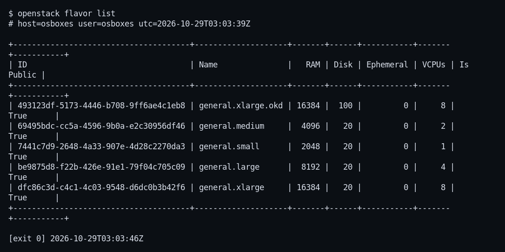

Também conferimos a imagem `ubuntu-24.04` e o estado do balanceador antes de
tocá-lo (T1.5). O `poi-atividades` já existia, `ACTIVE/ONLINE`, com uma lista de
listeners de outros grupos — a razão de as nossas portas externas serem outras.

### 4.2 Par de chaves

A chave foi gerada pela nuvem (`openstack keypair create`), com a privada
gravada fora do repositório e permissão `600` na VDI:

```bash
openstack keypair create --private-key atividade3-daniel-ranya.pem atividade3-daniel-ranya
chmod 600 atividade3-daniel-ranya.pem
```

| Item | Valor |
| --- | --- |
| Nome | `atividade3-daniel-ranya` |
| Tipo | RSA 2048 |
| Impressão digital | `SHA256:wtHrA6TDO3pWhlcwIwdZDyNUjd7cAVOO+70TqJGQLVE` |
| Permissão da privada | `-rw-------` |

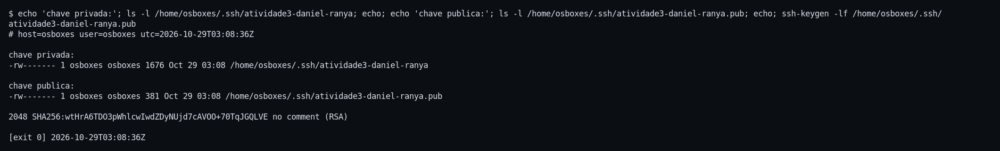

### 4.3 Criação da VM

```bash
openstack server create \
  --flavor general.small \
  --image ubuntu-24.04 \
  --key-name atividade3-daniel-ranya \
  --network provider \
  --security-group sg-daniel-ranya \
  vm-daniel-ranya
```

A VM subiu `ACTIVE`, com a rede `provider` e o endereço `10.5.9.15`. A imagem
`ubuntu-24.04` entrega Ubuntu 24.04.3 com Python 3.12, o que atende ao requisito
das aplicações (Python 3.10+).

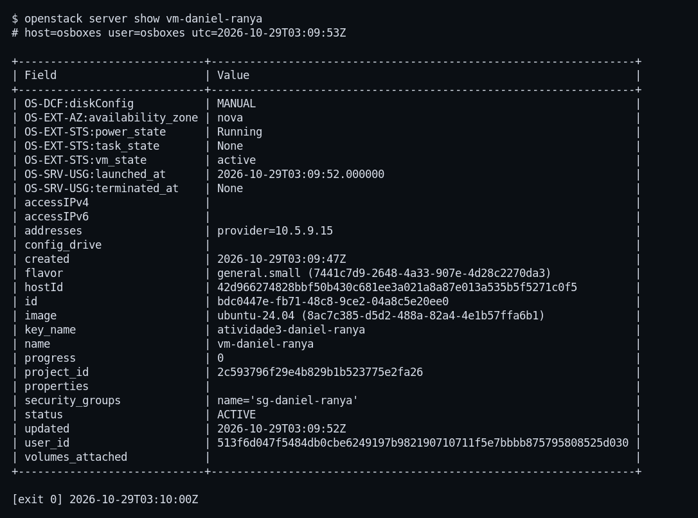

### 4.4 Grupo de segurança

O grupo `sg-daniel-ranya` abre **só o necessário**, e apenas para a rede de onde
o balanceador entrega o tráfego — não para a internet:

| Direção | Protocolo | Porta | Origem |
| --- | --- | --- | --- |
| ingress | TCP | 22 | `10.5.8.0/22` |
| ingress | TCP | 8000-8002 | `10.5.8.0/22` |
| ingress | ICMP | — | `10.5.8.0/22` |
| egress | IPv4/IPv6 | qualquer | — |

O ICMP foi incluído para permitir diagnóstico de rede (ping) a partir da VDI.

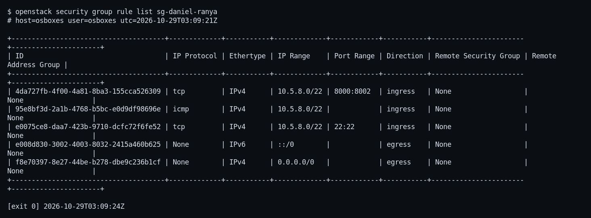

### 4.5 SSH pela VIP

O acesso SSH à VM passa pelo balanceador, como o item 6 da primeira parte pede:

| Objeto | Nome | Configuração |
| --- | --- | --- |
| Listener | `ssh-daniel-ranya` | TCP, porta **2222** |
| Pool | `pool-ssh-daniel-ranya` | balanceamento `SOURCE_IP_PORT` |
| Membro | `vm-daniel-ranya` | `10.5.9.15:22`, `ONLINE` |

O pool já vinha com um health monitor TCP do próprio balanceador compartilhado;
a tentativa de criar outro devolveu **HTTP 409 "This pool already has a health
monitor"**, registrada na evidência `T4.1-hm-create`. A decisão foi manter o
monitor existente, que faz exatamente a mesma checagem, em vez de removê-lo.

```bash
ssh -i ~/.ssh/atividade3-daniel-ranya -p 2222 ubuntu@150.165.85.77
# ubuntu@vm-daniel-ranya
```

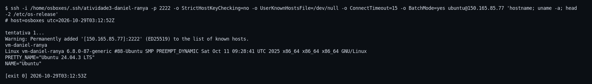

### 4.6 Deploy das aplicações

As três aplicações são as da Atividade 2, sem alteração de lógica: Python 3 com
biblioteca padrão, `GET /health` e `GET /work?size=N`. Foram enviadas para
`/opt/atividade3/apps` e conferidas byte a byte — o **SHA-256 de cada arquivo na
VDI é igual ao da VM**:

```text
a1cf580a...  /home/osboxes/atividade3/apps/cpu/server.py
a1cf580a...  /opt/atividade3/apps/cpu/server.py
```

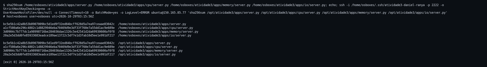

Cada perfil roda como um serviço `systemd` independente (`app-cpu`,
`app-memory`, `app-io`), com unit própria e endurecimento:

```ini
NoNewPrivileges=true
PrivateTmp=true
ProtectHome=true
ProtectSystem=full
ReadWritePaths=/var/log/atividade3/cpu /mnt/atividade3-logs/cpu
```

Os três foram habilitados no boot e iniciados com `systemctl enable --now`. O
script `a3-smoke`, instalado em `/usr/local/bin`, verifica `/health` e `/work`
nos três perfis e sai com código diferente de zero se algum falhar.

| Perfil | Porta interna | Porta externa | Trabalho por requisição | Concorrência máxima |
| --- | --- | --- | --- | --- |
| cpu | 8000 | 8100 | SHA-256 repetido sobre 1 MiB | 32 |
| memory | 8001 | 8101 | alocação e escrita de `size` MiB | 4 |
| io | 8002 | 8102 | escrita + `fsync` + releitura | 16 |

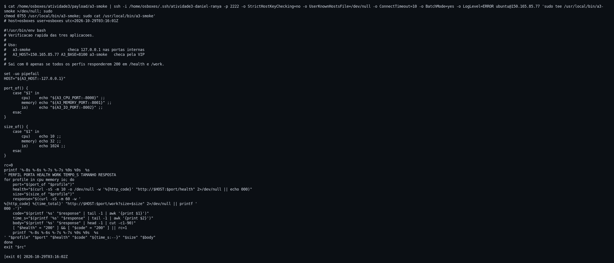

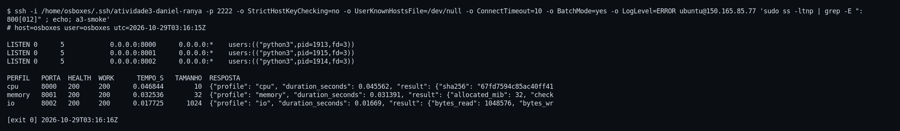

### 4.7 Volume de 1 GB e logs no volume

```bash
openstack volume create --size 1 vol-daniel-ranya-logs
openstack server add volume vm-daniel-ranya vol-daniel-ranya-logs --device /dev/vdb
# na VM
mkfs.ext4 -L a3logs /dev/vdb
mount LABEL=a3logs /mnt/atividade3-logs
```

O volume aparece como `/dev/vdb`, formatado em ext4 com o rótulo `a3logs` e
montado em `/mnt/atividade3-logs`:

```text
TARGET               SOURCE   FSTYPE OPTIONS
/mnt/atividade3-logs /dev/vdb ext4   rw,relatime

/dev/vdb        974M   24K  948M   1% /mnt/atividade3-logs
```

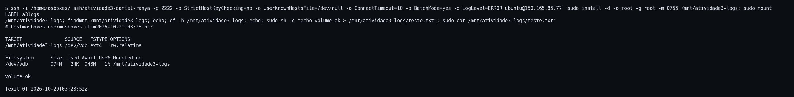

A montagem foi gravada no `/etc/fstab` **pelo rótulo**, e não por `/dev/vdb`: o
nome do dispositivo pode mudar se o volume for desanexado e reanexado, o rótulo
não. A entrada usa `nofail`, para que a VM suba mesmo se o volume faltar.

A prova de persistência foi um `reboot` de verdade: depois de reiniciar, a
montagem voltou sozinha e um arquivo marcador criado antes continuava lá (T6.4).

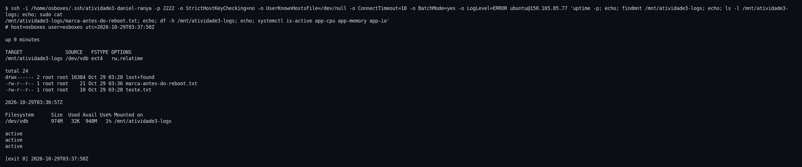

**Logs no volume.** Cada serviço recebeu um drop-in que redireciona a saída para
o volume:

```ini
[Service]
StandardOutput=append:/mnt/atividade3-logs/cpu/app.log
StandardError=append:/mnt/atividade3-logs/cpu/app.log
```

A prova de que o log está mesmo no volume foi feita pelo ponto de montagem de
cada arquivo, e não pela aparência do caminho:

```text
/mnt/atividade3-logs/cpu/app.log    -> montado em /mnt/atividade3-logs
/mnt/atividade3-logs/memory/app.log -> montado em /mnt/atividade3-logs
/mnt/atividade3-logs/io/app.log     -> montado em /mnt/atividade3-logs
```

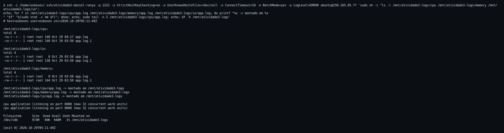

O que aparece no log: uma linha de inicialização por serviço e os *tracebacks*
que o `http.server` imprime no `stderr` quando um cliente fecha a conexão no
meio da resposta — o gerador de carga faz isso ao encerrar cada janela de 45 s.
São 137 ocorrências no perfil CPU e 158 no IO depois de todas as execuções. Não
são erros da aplicação: a requisição correspondente terminou 2xx; é o registro do
socket já fechado. O volume inteiro ficou em ~450 KB, dos quais 16 KB são o
`lost+found` do ext4.

O `logrotate` foi configurado com rotação diária, 7 cópias e `copytruncate` — a
aplicação mantém a saída aberta pelo `systemd`, então truncar o arquivo em vez de
renomeá-lo evita que ela continue escrevendo no arquivo renomeado. A rotação foi
forçada em teste e produziu `app.log.1`, visível na listagem acima.

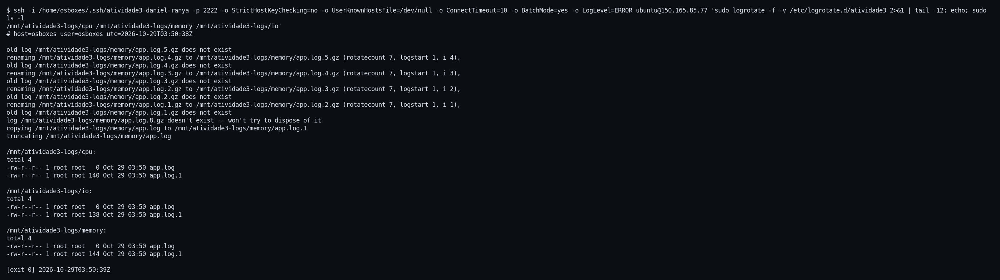

### 4.8 Aplicações pelo balanceador

Três listeners, três pools e três monitores HTTP, todos no balanceador
compartilhado:

| Listener | Porta | Pool | Monitor | Membro |
| --- | --- | --- | --- | --- |
| `app-cpu-daniel-ranya` | 8100 | `pool-app-cpu-daniel-ranya` | HTTP `/health`, 200 | `10.5.9.15:8000` |
| `app-memory-daniel-ranya` | 8101 | `pool-app-memory-daniel-ranya` | HTTP `/health`, 200 | `10.5.9.15:8001` |
| `app-io-daniel-ranya` | 8102 | `pool-app-io-daniel-ranya` | HTTP `/health`, 200 | `10.5.9.15:8002` |

O monitor usa `delay 5`, `timeout 4` e `max-retries 3`: um membro só sai de
rotação depois de três falhas seguidas, o que evita tirar a aplicação do ar por
um pico momentâneo.

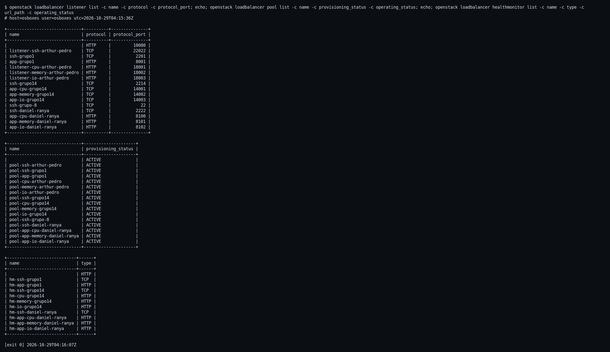

O teste externo, feito da VDI, respondeu 200 nos três perfis, tanto em `/health`
quanto em `/work`:

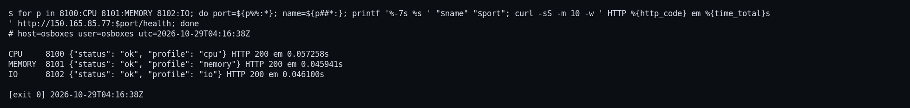

**Teste de falha.** Para provar que o health check funciona de verdade, paramos o
`app-cpu` e esperamos. O membro foi para `ERROR` e a porta 8100 passou a
responder **503**; as portas 8101 e 8102 continuaram respondendo normalmente.
Com o serviço de volta, o membro voltou a `ONLINE` e a porta 8100 respondeu 200
de novo.

| Momento | `app-cpu` | Membro | `GET /health` em 8100 |
| --- | --- | --- | --- |
| 1 | parado | — | — |
| 2 | após ~40 s | `ERROR` | **503** |
| 3 | reiniciado | — | — |
| 4 | após ~45 s | `ONLINE` | **200** |

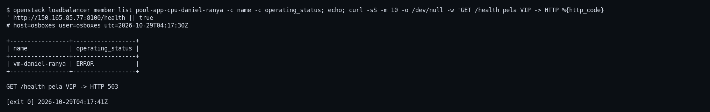

Isso mostra uma vantagem do desenho com três serviços separados: a falha de um
perfil não derruba os outros.

### 4.9 Snapshot da VM configurada

Com tudo no lugar — aplicações habilitadas, volume no `fstab`, logs no volume,
balanceador servindo os três perfis — tiramos o snapshot:

```bash
openstack server image create --name snap-vm-daniel-ranya vm-daniel-ranya
```

| Campo | Valor |
| --- | --- |
| ID | `7fb6d24c-583d-4f04-b843-5a1a35424816` |
| Status | `active` |
| Formato | `qcow2` |
| Tamanho | 1.983.840.256 bytes ≈ 1,85 GiB |
| `image_type` | `snapshot` |
| `instance_uuid` | `bdc0447e-...` (a VM) |
| Visibilidade | `private` |

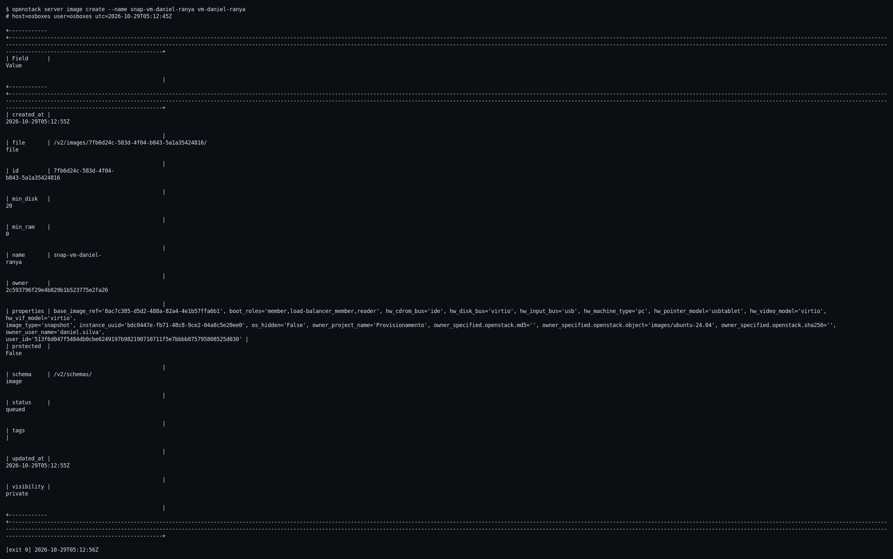

Depois do snapshot, conferimos que a VM continuou `ACTIVE` e o volume continuou
`in-use` em `/dev/vdb` — a operação não interrompeu o serviço.

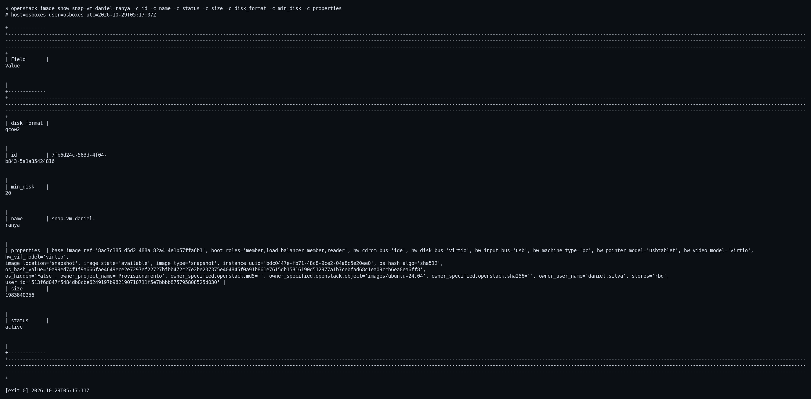

---

## 5. Experimentos de carga

### 5.1 Como foi medido

- **Gerador na VDI, fora da VM.** A latência registrada é a que o cliente vê:
  inclui a conexão TCP, a fila no servidor e a volta pela VIP do balanceador.
  Medir dentro da aplicação esconderia exatamente a parte que depende do
  provisionamento.
- **Monitor dentro da VM.** Um processo lê CPU, memória e swap a cada 0,5 s
  (biblioteca `psutil`), porque só o sistema operacional de dentro vê o que a
  nuvem entregou.
- **5 s de aquecimento descartados**, em arquivo separado, antes dos **45 s
  medidos**. Janela fixa por duração, para que os níveis sejam comparáveis.
- **Nove execuções:** cada perfil com 1, 2 e 4 clientes concorrentes, sempre pela
  VIP — o mesmo caminho de acesso criado na etapa 4.8.

### 5.2 Resultados

| Cenário | Conc. | Req. | OK | Erros | rps | média (ms) | p50 (ms) | p95 (ms) | CPU VM (%) | RAM VM (%) |
| --- | --- | --- | --- | --- | --- | --- | --- | --- | --- | --- |
| cpu-c1 | 1 | 413 | 413 | 0 | 9,2 | 109,0 | 109,8 | 116,9 | 43,2 | 17,8 |
| cpu-c2 | 2 | 625 | 625 | 0 | 13,9 | 144,1 | 142,8 | 158,4 | 53,6 | 17,2 |
| cpu-c4 | 4 | 889 | 889 | 0 | 19,7 | 202,6 | 206,3 | 245,4 | 69,1 | 17,3 |
| memory-c1 | 1 | 493 | 493 | 0 | 10,9 | 91,4 | 91,2 | 96,3 | 39,5 | 18,6 |
| memory-c2 | 2 | 758 | 758 | 0 | 16,8 | 119,0 | 115,5 | 131,5 | 48,0 | 20,0 |
| memory-c4 | 4 | 1331 | 1331 | 0 | 28,9 | 136,2 | 126,3 | 167,9 | 71,0 | 20,9 |
| io-c1 | 1 | 789 | 789 | 0 | 17,5 | 57,0 | 56,4 | 61,0 | 6,2 | 17,0 |
| io-c2 | 2 | 1576 | 1576 | 0 | 35,0 | 57,1 | 56,3 | 62,7 | 11,7 | 17,1 |
| io-c4 | 4 | 1724 | 1724 | 0 | 37,5 | 106,2 | 58,1 | 84,7 | 14,5 | 17,1 |

**Total: 8.598 requisições, todas 2xx, nenhum erro.** Os limites de concorrência
das aplicações (32, 4 e 16) não foram atingidos em nenhum cenário; o que cresceu
foi a latência, não a taxa de rejeição.

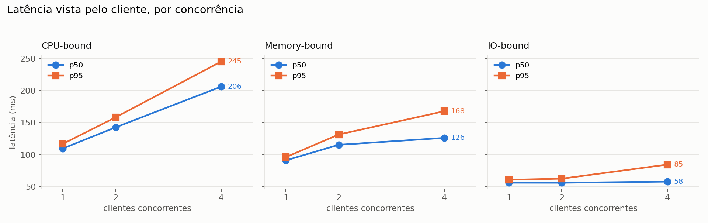

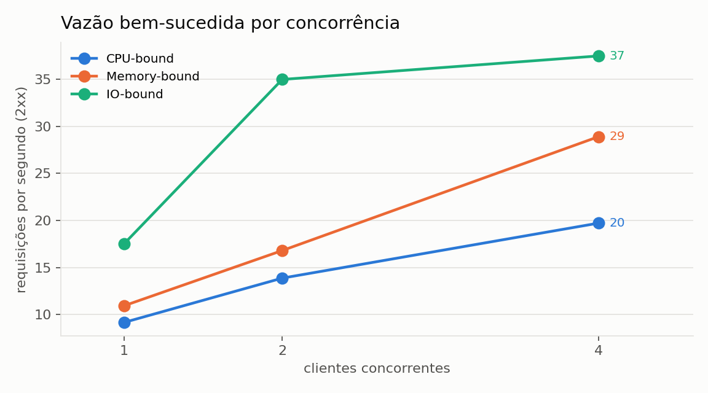

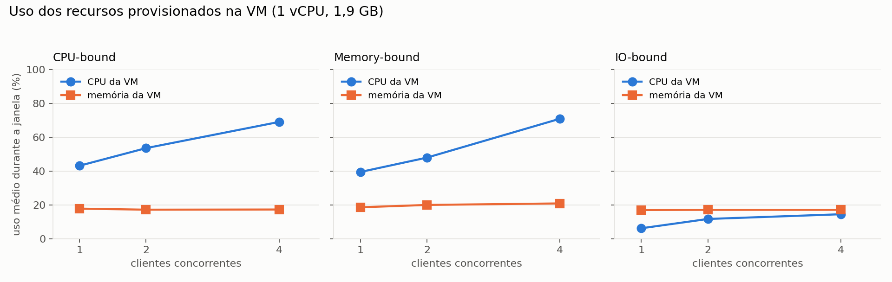

### 5.3 Análise

**Coerência da medição.** Com clientes fechados, o produto vazão × latência tem
de dar o número de clientes em voo (lei de Little). Nas nove linhas o produto
fechou entre 0,9997 e 3,9955 — dentro de 1,6 % de 1, 2 e 4. Vazão e latência
foram medidas em lados diferentes; se uma estivesse errada, o produto não daria
a concorrência.

**CPU-bound é o perfil que satura primeiro.** A vazão vai de 9,2 para 13,9 e
depois 19,7 rps, mas a latência média quase dobra (109 → 203 ms) e a CPU da VM
chega a 69 % com picos de 100 %. Com 1 vCPU, cada cliente adicional espera na
fila do sistema operacional; ganhar mais vazão exigiria mais núcleos, e não mais
clientes.

**Memory-bound cresce de forma mais equilibrada.** A vazão sobe de 10,9 para
28,9 rps com a latência entre 91 e 136 ms. A memória sai de 18,6 % para 20,9 %
porque cada requisição aloca 32 MiB e libera em seguida — o pico importa mais que
a média. O **swap ficou em 0 MiB em todas as amostras**: 2 GB bastaram, não houve
pressão de memória.

**IO-bound é o mais barato em CPU e o primeiro a saturar em vazão.** Usa 6 % a
14 % de CPU, porque a thread passa a maior parte do tempo esperando o `fsync`. A
vazão quase dobra de 1 para 2 clientes (17,5 → 35,0 rps) e praticamente para em
37,5 rps com 4, enquanto a latência p50 continua em 58 ms. O `io-c4` tem uma
cauda longa: p99 de 1.064 ms e máximo de 1.093 ms, com poucas requisições muito
lentas. É contenção de escrita no volume, não servidor saturado — por isso a
média (106 ms) está longe da mediana (58 ms). Esse é o argumento para olhar p95 e
p99, e não só a média.

**Leitura de provisionamento.** Para esta carga, 1 vCPU e 2 GB são adequados a
IO e memory até 4 clientes; o CPU-bound é limitado pelo único núcleo. O volume de
1 GB ficou com cerca de 450 KB usados depois de todas as execuções e uma rotação
forçada, o que confirma que 1 GB é folgado para logs com `logrotate`.

---

## 6. Dificuldades encontradas

1. **Balanceador compartilhado e imutável.** Enquanto outro grupo aplicava uma
   mudança, o `poi-atividades` respondia **HTTP 409 "is immutable"**. As fases de
   criação passaram a tentar de novo com pausa, e a parar quando o erro é
   definitivo (recurso já existe), para não gastar minutos repetindo o que nunca
   vai passar.
2. **Health monitor já existente no pool de SSH.** A criação de um monitor TCP
   retornou 409 porque o pool já tinha um. Optamos por manter o existente.
3. **Portas ocupadas na VIP.** A lista de listeners mostrou 8000-8002 e 2222 em
   uso por outros grupos. A solução foi publicar em 2222 e 8100-8102.
4. **VM sem IP flutuante.** Não havia endereço público para a VM; todo acesso
   (SSH e aplicações) teve de passar pelo balanceador, o que na prática virou uma
   vantagem: o caminho testado é o caminho real.
5. **Log em arquivo em uma aplicação que silencia o log.** As aplicações da
   Atividade 2 não gravavam nada. O `systemd` passou a redirecionar a saída para o
   volume, e o `log_message` continua silenciado de propósito, para não somar I/O
   às medições.
6. **Rotação com arquivo aberto.** O `logrotate` precisou de `copytruncate`,
   porque o `systemd` mantém a saída aberta e o arquivo renomeado continuaria
   recebendo escrita.
7. **Falha transitória da nuvem.** Uma checagem do plugin do Octavia falhou uma
   vez logo após o login e passou nas seguintes. A checagem passou a tentar três
   vezes com pausa.
8. **Primeira matriz de carga perdida.** Uma execução foi interrompida antes do
   fim; a matriz foi repetida inteira e só os dados da execução completa ficaram
   registrados.

---

## 7. Conclusão

A atividade mostrou a diferença entre **provisionar** e **operar**. Provisionar
foi criar chave, VM, grupo de segurança, volume e listeners — cada passo com um
comando de CLI e uma evidência. Operar foi o que veio depois: descobrir que o
balanceador é compartilhado e imutável, que a VM não tem IP público, que um
serviço com log aberto precisa de `copytruncate`, e que um health check só vale
se for testado derrubando o serviço de propósito.

Os números dos experimentos fecham com o que a infraestrutura oferece: 1 vCPU
satura o perfil CPU-bound em torno de 20 rps com 4 clientes, o perfil de memória
cresce sem tocar o swap, e o de I/O para em 37,5 rps por contenção de escrita. O
volume de 1 GB, usado para os logs, ficou com cerca de 450 KB ocupados após
todas as execuções e uma rotação — a escolha de tamanho se mostrou adequada, e a
rotação funciona.

Todos os itens pedidos foram entregues: par de chaves, uma VM `general.small`
com `ubuntu-24.04`, grupo de segurança, SSH pela VIP, aplicações pela VIP, volume
de 1 GB montado e usado para logs, e snapshot da VM configurada. O repositório
guarda a transcrição de cada comando (`evidencias/`), um registro por task
(`docs/execucao/`) e os dados brutos dos experimentos (`results/`).

---

## 8. Apêndice — onde está cada evidência

| Conteúdo | Onde |
| --- | --- |
| Transcrição literal de cada comando | `evidencias/T<fase>.<n>-*.txt` |
| Print de cada transcrição | `evidencias/T<fase>.<n>-*.png` |
| Índice das evidências (task, arquivo, tamanho, sha256, dimensões) | `evidencias/manifest.csv` |
| Registro por task (objetivo, comandos, decisões, problemas) | `docs/execucao/T*.md` |
| Índice dos registros | `docs/execucao/INDEX.md` |
| Dados brutos dos experimentos | `results/measurements.csv`, `results/warmup.csv`, `results/resources-*.csv` |
| Resumo consolidado dos experimentos | `results/summary.csv` |
| Gráficos | `docs/graficos/*.png` |
| Scripts das fases automatizadas | `automation/remote/*.sh` |
| Gerador de carga e monitor | `scripts/load_test.py`, `scripts/monitor.py` |
| Geração dos gráficos e do manifesto | `scripts/make_charts.py`, `scripts/make_manifest.py` |

**Cobertura das evidências:** 123 transcrições, 123 prints, 41 tasks — todas com
print; nenhuma evidência textual ficou sem imagem.
